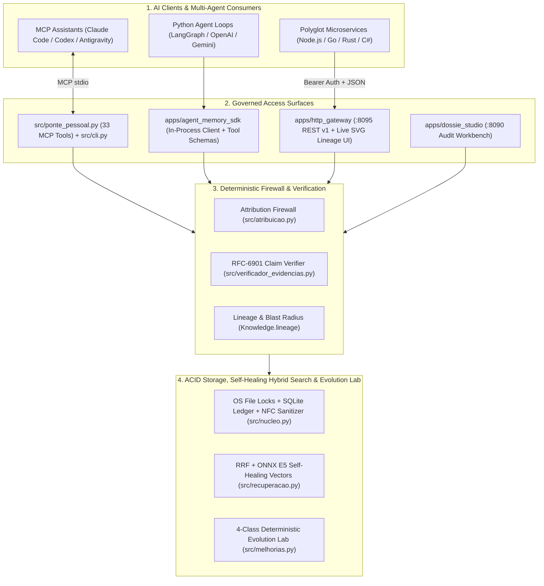

# Epistemic Memory Core — Universal Governed Memory Protocol for AI Agents

> **Local-first transactional memory, premise governance, deterministic claim verification, and self-healing hybrid search engine for AI assistants and multi-agent pipelines — accessible via MCP, in-process Python SDK, REST HTTP Gateway, and Obsidian.**

🇧🇷 [Leia em Português](README.md) · 🏛️ [Epistemic Dossier Studio](apps/dossie_studio/README.md) · 🧠 [Agent Memory SDK](apps/agent_memory_sdk/README.md) · 🕸️ [HTTP Gateway & Lineage UI](apps/http_gateway/README.md) · 📖 [Formal Architecture Manual (17 Chapters, PT-BR)](00_Manual/indice-manual-cerebro.md)

[](https://github.com/leoguimaraes49/epistemic-memory-core/actions/workflows/testes.yml)
[](https://www.python.org/)
[](https://modelcontextprotocol.io/)
[-green.svg)](https://github.com/microsoft/onnxruntime)
[](https://obsidian.md/)
[](#automated-test-suites-27-official-suites)
[](https://github.com/leoguimaraes49/epistemic-memory-core/releases/tag/v0.5.8)


---

## Why Epistemic Memory Core?

Giving LLM agents direct write access to raw Markdown notes or flat vector databases breaks down in four predictable ways:

1. **Premise Drift Without Invalidation:** When a primary source (a vendor quote, contract clause, or user report) changes, downstream summaries and conclusions keep getting retrieved as if their underlying basis were still valid.
2. **Misattribution:** In multi-speaker notes or external documents, agents routinely bind a quote, pronoun, or numeric metric from Person B onto Person A's profile.
3. **Dirty Reads & Torn Writes:** Crashing or racing between writing a `.md` file and committing metadata exposes unconfirmed or truncated files to readers or creates duplicate records on retry.
4. **Silent Blending of Fact and Inference:** Raw observations, screening scores, and AI-generated hypotheses get flattened into indistinguishable prose.

**Epistemic Memory Core** enforces deterministic rules in Python before data hits disk: immutable `UUIDv4` identities, revision chains, raw-byte `SHA-256` digests, strict separation between **primary sources** (`30_Fontes`) and **derived knowledge**, OS-level concurrency locks held across SQLite commits, deterministic upstream/downstream lineage introspection (`Knowledge.lineage`), cascade *stale-on-write* invalidation, a 4-class bounded self-evolution lab, and a zero-LLM standard-library claim verifier (`lab-assurance-2`).

---

## System Architecture



---

## Key Engineering Guarantees

- **Transactional Proposal & Confirmation (`src/nucleo.py`, `src/conhecimento.py`):** Every write requires an idempotency `operation_key`. The engine stages proposals in SQLite (`PRAGMA synchronous=FULL`), reserves NFC-normalized filenames atomically (blocking Windows device stems, control/BiDi spoofing characters, and null bytes), holds exclusive OS file locks (`CreateFileW dwShareMode=0` on Windows; `flock` + `pread`/`fstat` verification on Linux & macOS) across `fsync` and SQLite `COMMIT`, and blocks truncated or unconfirmed files from catalog reads (*anti-dirty-read*).
- **Deterministic Lineage & Blast-Radius Introspection (`Knowledge.lineage` / CLI `linhagem`):** Cycle-safe BFS + 3-color DFS graph introspection returning target integrity, direct & transitive upstream bases (`30_Fontes` and intermediate records with `pinned_revision` vs. `current_revision` and `SHA-256` validity), and downstream dependents grouped into `active` vs. `suspended`.
- **Strict Attribution Firewall (`src/atribuicao.py`):** Cross-checks person entities, aliases, homonyms, pronouns, and literal quotes before recording personal or third-party assertions — blocking cross-speaker swaps and external-document first-person leakage.
- **Zero-LLM Deterministic Claim Verifier (`src/verificador_evidencias.py`, `src/evidencias.py`):** Pure Python stdlib verifier checking strict RFC-6901 JSON pointers (`field`), exact integer sums (`sum`, rejecting `bool` smuggling and overflow), and acyclic transitive chains (`chain`), issuing `lab-assurance-2` receipts that automatically turn `stale` when the vault generation advances.
- **Self-Healing Local Hybrid Search (`src/recuperacao.py`):** Combines lexical matching, local `intfloat/multilingual-e5-small` ONNX embeddings (packed `float64` SQLite `BLOB`s + vectorized NumPy scoring), and graph expansion via Reciprocal Rank Fusion (RRF) — automatically detecting and re-indexing truncated, `NaN`/`Inf`, or dimension-mismatched vector blobs without crashing search.
- **4-Class Deterministic Self-Evolution Lab (`src/melhorias.py`):** AST-sandboxed evaluator supporting reproducible benchmarking, atomic adoption, LIFO rollback, and cryptographic chain auditing (`audit_adoption_chain()`, `diagnostics_summary()`) across `message_codec`, `retrieval_policy`, `vector_storage`, and `batch_limits` while strictly prohibiting privilege or model-budget escalation.

---

## Universal Adapters & Included Applications (`apps/`)

### 1. Epistemic Agent Memory SDK (`apps/agent_memory_sdk/`)
In-process Python SDK and LLM Function-Calling adapter for **LangGraph**, **OpenAI Agents**, **Google Gemini SDK**, and custom multi-agent pipelines without requiring MCP `stdio`:
- Typed governed methods: `make_operation_key()`, `remember_source()`, `rectify_source()`, `register_entity()`, `assert_fact()`, `synthesize()`, `prepare_decision()`, `verify_claims()`, `recall_context()`, and `blast_radius()`.
- Ready-to-use tool schemas (`as_openai_tools(strict=True)`, `as_gemini_declarations()`) and `dispatch_tool_call(name, arguments)` returning structured JSON with deterministic error codes (`ATTRIBUTION_FIREWALL_BLOCKED`, `REVISION_CONFLICT`, `VALIDATION_ERROR`, etc.).

```bash
./.venv/bin/python apps/agent_memory_sdk/cli_demo.py --workspace ./testes_temporarios/sdk-demo --cleanup
```

### 2. Epistemic HTTP Gateway & Live Lineage Graph Explorer (`apps/http_gateway/`)
Hardened pure-stdlib `ThreadingHTTPServer` (`127.0.0.1:8095`) exposing governed epistemic memory over REST JSON v1 (`/api/v1/health`, `/api/v1/graph`, `/api/v1/lineage/<id>`, `/api/v1/sources`, `/api/v1/sources/rectify`, `/api/v1/knowledge`, `/api/v1/verify-claims`, `/api/v1/search`) for **Node.js, Go, Rust, C#, and webhooks**, paired with a zero-dependency interactive **SVG Knowledge Graph & Blast-Radius Inspector** at `GET /`:
- Enforces loopback binding, strict `Host` DNS-rebinding protection (`HTTP 403`), constant-time `hmac.compare_digest` Bearer authentication (`HTTP 401`), `64 KB` body cap (`HTTP 413`), `Content-Security-Policy`, and XSS escaping.

```bash
CEREBRO_PESSOAL_ACESSO=permitido ./.venv/bin/python apps/http_gateway/cli.py --workspace ./testes_temporarios/gw-demo serve --port 8095 --seed-demo
# Open http://127.0.0.1:8095 (or run `emc-gateway` after editable install)
```

### 3. Epistemic Dossier Studio (`apps/dossie_studio/`)
Interactive local audit workbench (`127.0.0.1:8090`) and CLI with three 1-click scenarios (*Engineering & Cloud GPU RFQ*, *Legal MSA & Addenda*, and *Applied Research Protocol with Reverse-Scored Items*):

```bash
./.venv/bin/python apps/dossie_studio/cli.py --workspace ./my-dossier serve --preload engenharia_cotacao
# Open http://127.0.0.1:8090 (or run `emc-dossie` after editable install)
```

---

## Repository Layout

```text
├── 00_Manual/                   # Formal 17-chapter normative specification (SHA-256 manifest protected)
├── apps/
│   ├── agent_memory_sdk/        # In-process Python SDK + OpenAI/Gemini tool-calling adapter
│   ├── dossie_studio/           # Interactive decision/contract audit workbench (:8090) + CLI
│   └── http_gateway/            # REST JSON v1 gateway (:8095) + interactive SVG Lineage Explorer
├── config/                      # Runtime & queue manifests (autonomia.json, execucao.json, manual_manifest.json)
├── docs/                        # Architecture diagrams (arquitetura.jpg, architecture-en.jpg) & guides
├── scripts/                     # Vault initializer, scale benchmark & 6-worker chaos stress harness
│   ├── benchmark_escala.py
│   ├── stress_caos_concorrencia.py
│   ├── iniciar-template.py
│   └── iniciar-trabalhador.ps1
├── src/                         # Core transactional & epistemological engine (24 Python modules)
├── tests/                       # 27 official automated test suites + 2 MCP regression scripts
└── pyproject.toml               # v0.5.8 package metadata & 6 CLI entrypoints (emc, emc-mcp, emc-dashboard, emc-verifier, emc-dossie, emc-gateway)
```

---

## Quickstart

### 1. Clone & Install (Python 3.11 or 3.12)

```bash
git clone https://github.com/leoguimaraes49/epistemic-memory-core.git
cd epistemic-memory-core

python3 -m venv .venv
./.venv/bin/python -m pip install -r requirements-execucao04.txt
# Optional editable install (exposes emc, emc-mcp, emc-dashboard, emc-verifier, emc-dossie, emc-gateway):
./.venv/bin/python -m pip install --no-deps -e .
```

*(On Windows PowerShell, use `.\.venv\Scripts\python.exe`.)*

### 2. Initialize a Clean Obsidian Vault, Inspect Lineage & Launch Dashboard

```bash
./.venv/bin/python scripts/iniciar-template.py --destino ./meu-cofre --nome "My Vault"
./.venv/bin/python src/dashboard.py
# Operational Dashboard at http://127.0.0.1:8080
# Inspect upstream/downstream lineage of any record from CLI:
./.venv/bin/python src/cli.py linhagem <RECORD_ID>
```

### 3. Connect Your AI Assistant via MCP (33 Tools)

```json
{
  "mcpServers": {
    "cerebro_pessoal": {
      "command": "/absolute/path/epistemic-memory-core/.venv/bin/python",
      "args": ["/absolute/path/epistemic-memory-core/src/ponte_pessoal.py"],
      "env": { "CEREBRO_PESSOAL_ACESSO": "permitido" }
    }
  }
}
```

---

## Automated Test Suites (27 Official Suites)

The engine and all adapters are validated by **27 automated suites** in [`tests/`](tests/) running on GitHub Actions across **Ubuntu 24.04 (Python 3.11 & 3.12)**, **macOS 15 Apple Silicon (Python 3.12)**, and **Windows Server 2022 (Python 3.12)**.

Download the pinned `intfloat/multilingual-e5-small` ONNX files into `modelos/e5-multilingual-small/` (verified by `SHA-256` before loading; links in [`README.md`](README.md#busca-vetorial-local-onnx-e5)) to run the full cryptographic test gate and multi-process chaos harness:

```bash
# Run all 27 official suites with code-hash verification
CEREBRO_PESSOAL_ACESSO=permitido ./.venv/bin/python src/cli.py autotestes

# Run the 6-process chaos, CAS contention, ONNX E5 & lease-recovery stress harness
CEREBRO_PESSOAL_ACESSO=permitido ./.venv/bin/python scripts/stress_caos_concorrencia.py --workers 6 --ops 15
```

### Suite Coverage Highlights:
- **Universal Adapters (`3 suites`):** `testes_agent_sdk.py` (Python SDK & OpenAI/Gemini tool calling), `testes_http_gateway.py` (REST API v1, auth/Host/body hardening & SVG UI), and `testes_dossie_studio.py` (engineering, legal & research audit scenarios).
- **Motor Hardening, Adversarial Fuzzing & Chaos (`3 suites`):** `testes_hardening_motor.py` (`Knowledge.lineage`, CLI `linhagem`, ONNX E5 corrupt-blob self-healing, RFC-6901 & `bool`/`chain` guards, NFC/device-stem sanitization), `testes_fuzz_caos.py` (seeded path/Unicode fuzzing, 5-speaker attribution matrix, `os._exit` crash & anti-dirty-read blocks), and `testes_auditoria_escala.py` (hundreds-of-records scale & POSIX path parity).
- **Self-Evolution Laboratory (`3 suites`):** `testes_evolucao_lab.py` (4-class deterministic evaluators, LIFO rollback & `audit_adoption_chain()`), `testes_melhorias_seguranca.py` (AST sandbox isolation & symlink/reparse defenses), and `testes_operacao_melhorias.py`.
- **Core ACID Engine, Attribution, Queue & MCP (`18 suites`):** `testes.py`, `testes_conhecimento.py`, `testes_autonomia.py`, `testes_decisao.py`, `testes_esquemas.py`, `testes_recuperacao.py`, `testes_coordenador.py`, `testes_execucao.py`, `testes_runtime.py`, `testes_provedores.py`, `testes_mcp_vetores.py`, `testes_evidencias.py`, `testes_persistencia05.py`, `testes_mcp05.py`, `testes_recuperacao_fila.py`, `testes_atribuicao.py`, `testes_continuacoes07.py`, and `testes_dashboard.py` (plus standalone MCP scripts `teste_mcp.py` and `testes_mcp04.py`).

---

## License

Published under a custom **Non-Commercial Source-Available License** ([`LICENSE`](LICENSE)), authored by **Leonardo Guimarães (`@leoguimaraes49`)**:
- **Permitted:** Personal non-commercial use, academic research, educational study, and technical portfolio evaluation.
- **Reserved:** Commercial use, resale, SaaS/hosted offerings, and enterprise production deployments require prior written commercial licensing from the Author.
