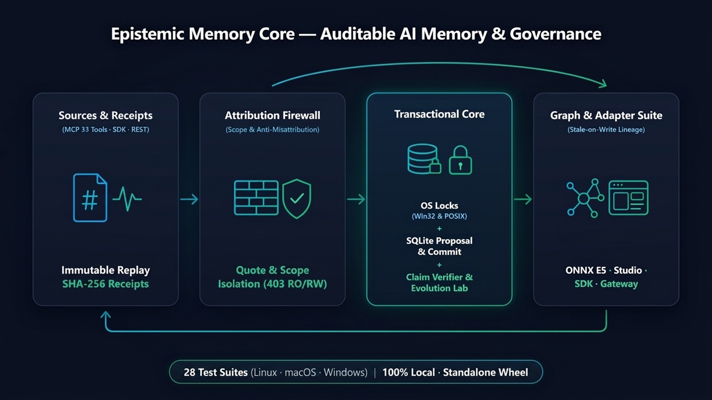

# Epistemic Memory Core — Local-First Governed Memory Protocol

> **Deterministic transactional memory, premise governance, standard-library claim verification, and self-healing local hybrid search over SQLite + Markdown — usable directly via CLI and local web workbenches, or optionally connected to AI agents via MCP, Python SDK, and REST HTTP Gateway.**

🇧🇷 [Leia em Português](README.md) · [Epistemic Dossier Studio](apps/dossie_studio/README.md) · [Agent Memory SDK](apps/agent_memory_sdk/README.md) · [HTTP Gateway](apps/http_gateway/README.md) · [Normative Manual (17 Chapters, PT-BR)](00_Manual/indice-manual-cerebro.md) · [Detailed Architecture (PT-BR)](docs/guias/ARQUITETURA.md) · [Privacy Policy](PRIVACY.md) · [Security](SECURITY.md)

[](https://github.com/leoguimaraes49/epistemic-memory-core/actions/workflows/testes.yml)
[](https://m8ven.ai/mcp/leoguimaraes49-epistemic-memory-core-19kbfa?s=readme)
[](https://www.python.org/)
[](https://modelcontextprotocol.io/)
[-green.svg)](https://github.com/microsoft/onnxruntime)
[](https://obsidian.md/)
[](#local-vector-search-and-28-automated-test-suites)
[](https://github.com/leoguimaraes49/epistemic-memory-core/releases/tag/v0.5.9)



> For scenario-specific Mermaid flowcharts, the end-to-end transactional sequence diagram, the 25-module `src/` reference table, and the 17-chapter normative index, see [`docs/guias/ARQUITETURA.md`](docs/guias/ARQUITETURA.md).

---

## What the Engine Solves

1. **Premise Drift Without Invalidation:** When a primary source (`30_Fontes`) is rectified or excluded, dependent assertions, syntheses, scores, and receipts automatically transition to review (*stale-on-write*), preserving full revision chains and deterministic blast-radius inspection (`Knowledge.lineage`).
2. **Cross-Speaker Misattribution:** The deterministic attribution firewall (`src/atribuicao.py`) validates person entities, aliases, pronouns, numeric metrics, and literal quotes before committing assertions — blocking cross-speaker swaps and first-person leakage from external documents.
3. **Dirty Reads, Torn Writes & Replay Drift:** Every mutation requires an idempotency `operation_key`, stages proposals in SQLite (`PRAGMA synchronous=FULL`), holds exclusive OS file locks across `fsync` and `COMMIT`, and binds an immutable historical operation receipt to that key — strictly separating historical revision proof from live `current_state` queries across restarts.
4. **Blending of Evidence and Inference:** Immutable primary sources (`30_Fontes`) stay physically separated from derived knowledge (`10_Entidades`, `20_Afirmacoes`, `50_Sinteses`), paired with a zero-LLM Python standard-library claim verifier (`lab-assurance-2`: RFC-6901 `field`, strict integer `sum`, and acyclic `chain`).

---

## Included Ecosystem (100% Functional Without Mandatory AI)

| Component | Role & Access Surface | AI Requirement |
| :--- | :--- | :--- |
| [`src/`](src/) ([Architecture](docs/guias/ARQUITETURA.md)) | **Core Engine, MCP Server (`ponte_pessoal.py`, 33 tools), CLI (`emc` / `linhagem`), Dashboard (`:8080`) & Evolution Lab (`melhorias.py`):** ACID storage, hybrid RRF search, and 4-class deterministic optimization. | **None** (MCP optional) |
| [`apps/dossie_studio/`](apps/dossie_studio/README.md) | **Epistemic Dossier Studio (`emc-dossie`, `:8090`):** local web workbench and CLI for auditing engineering quotes, legal contracts, and research protocols with *stale-on-write* simulation. | **None** |
| [`apps/agent_memory_sdk/`](apps/agent_memory_sdk/README.md) | **Agent Memory SDK (`in-process`):** typed Python client with immutable historical receipts per `operation_key`, isolated disposable demo cleanup, and optional OpenAI/Gemini/LangGraph tool schemas. | **Optional** (on-demand tool calling) |
| [`apps/http_gateway/`](apps/http_gateway/README.md) | **HTTP Gateway & SVG Graph (`emc-gateway`, `:8095`):** polyglot REST JSON v1 server + interactive SVG Lineage Explorer with `read_only` UI bootstrap sessions and `read_write` operator `Bearer` tokens. | **None** |

```bash
# Launch interactive Dossier Studio (presets: engenharia_cotacao, juridico_contrato, pesquisa_decisao)
./.venv/bin/python apps/dossie_studio/cli.py --workspace ./testes_temporarios/dossier serve --preload engenharia_cotacao

# Run multi-agent Python SDK demo (creates and cleans up only its own disposable child directory)
./.venv/bin/python apps/agent_memory_sdk/cli_demo.py --workspace ./testes_temporarios/sdk-demo --cleanup

# Start REST v1 Gateway + SVG Lineage Explorer at http://127.0.0.1:8095 and inspect lineage via CLI
./.venv/bin/python apps/http_gateway/cli.py --workspace ./testes_temporarios/gw-demo serve --port 8095 --seed-demo
./.venv/bin/python src/cli.py linhagem <RECORD_ID>
```

---

## Getting Started (Editable Clone vs. Standalone Wheel + Scope Authorization)

### 1. Install (Python 3.11 or 3.12 — Linux, macOS, and Windows)

```bash
git clone https://github.com/leoguimaraes49/epistemic-memory-core.git
cd epistemic-memory-core
python3 -m venv .venv
./.venv/bin/python -m pip install -r requirements-execucao04.txt

# Option A — Editable clone setup (exposes emc, emc-mcp, emc-dashboard, emc-verifier, emc-dossie, emc-gateway):
./.venv/bin/python -m pip install --no-deps -e .

# Option B — Standalone Wheel install (bundles 00_Manual/*.md and config/*.json in emc_resources to run outside the clone):
./.venv/bin/python -m pip install --no-deps .
```

*(On Windows PowerShell, replace `./.venv/bin/python` with `.\.venv\Scripts\python.exe`.)*

### 2. Workspace Scope Authorization (`EMC_SYSTEM`, `EMC_VAULT`, `EMC_AUTHORIZED_ROOTS`)
`nucleo.is_authorized_scope` validates workspace paths **before** creating any directory or SQLite file. By default, only the configured primary pair (`EMC_SYSTEM` + `EMC_VAULT`) and disposable paths under `testes_temporarios/` are permitted; unauthorized directories raise `Invalid("raiz fora do escopo autorizado")` while leaving empty target folders untouched.

To operate outside the git clone (for instance, from an installed `.whl` in a separate project), explicitly authorize the external root via **`EMC_AUTHORIZED_ROOTS`** (separated by `:` on Linux/macOS or `;` on Windows) or set `EMC_SYSTEM` and `EMC_VAULT`:

```bash
# Running outside the git clone from an installed wheel (emc, emc-gateway, emc-dossie, or Python SDK):
export CEREBRO_PESSOAL_ACESSO="permitido"
export EMC_AUTHORIZED_ROOTS="/srv/external-emc-workspaces"
export EMC_GATEWAY_TOKEN="local-operator-secret-token"

emc-gateway --workspace "/srv/external-emc-workspaces/audit-run" serve --port 8095 --seed-demo
```

To initialize a clean Obsidian vault inside the clone:
```bash
./.venv/bin/python scripts/iniciar-template.py --destino ./meu-cofre --nome "My Vault"
./.venv/bin/python src/dashboard.py   # Local operational dashboard at http://127.0.0.1:8080
```

### 3. HTTP Gateway Local Trust Boundary (`read_only` vs. `read_write`)
On shared machines or multi-agent sandboxes with mixed trust levels, loopback binding (`127.0.0.1:8095`) strictly separates visual graph inspection from mutations:

| Credential | Scope | Permitted Operations | Behavior on Mutating `POST` Endpoints |
| :--- | :--- | :--- | :--- |
| `ui_session_token` (bootstrapped via `GET /`) | `read_only` | `GET /api/v1/health`, `/api/v1/graph`, `/api/v1/lineage/<id>`, and non-mutating search | Rejected with **`HTTP 403`** (`insufficient_scope`) on `/sources`, `/sources/rectify`, `/knowledge`, and `/verify-claims` |
| Operator Token (`--api-token` / `EMC_GATEWAY_TOKEN`) | `read_write` | Full read access + source creation, rectification, knowledge writes, and `lab-assurance-2` claim receipts | Authorized via constant-time `Authorization: Bearer <token>` or unlocked in-memory in the UI header |

### 4. Optional MCP Assistant Configuration (33 Tools)
```json
{
  "mcpServers": {
    "cerebro_pessoal": {
      "command": "/absolute/path/epistemic-memory-core/.venv/bin/python",
      "args": ["/absolute/path/epistemic-memory-core/src/ponte_pessoal.py"],
      "env": { "CEREBRO_PESSOAL_ACESSO": "permitido" }
    }
  }
}
```
See also the operational guides (PT-BR): [Execution 0.2](docs/guias/EXECUCAO.md), [Autonomy 0.3](docs/guias/AUTONOMIA.md), and [Integrated Execution 0.4](docs/guias/EXECUCAO-INTEGRADA.md).

---

## Lean Repository Layout

```text
├── 00_Manual/                   # Immutable 17-chapter normative specification (SHA-256 manifest protected)
├── apps/                        # Applications and adapters built over canonical engine contracts
│   ├── agent_memory_sdk/        # In-process Python SDK + optional Function Calling (OpenAI, Gemini, LangGraph)
│   ├── dossie_studio/           # Web workbench (:8090) + CLI for engineering, legal & research audits
│   └── http_gateway/            # REST JSON v1 gateway (:8095) + SVG Explorer (read_only UI / read_write Bearer)
├── config/                      # Runtime & queue manifests (manual_manifest.json, execucao.json, autonomia.json)
├── docs/                        # Visual diagrams (arquitetura.jpg, architecture-en.jpg) & docs/guias/ARQUITETURA.md
├── scripts/                     # iniciar-template.py, benchmark_escala.py, stress_caos_concorrencia.py
├── src/                         # Core transactional engine (25 Python modules + emc_resources in wheel builds)
├── tests/                       # 28 official automated test suites + 2 standalone MCP regression scripts
├── LICENSE                      # Custom Non-Commercial Source-Available License
├── PRIVACY.md / SECURITY.md     # Local-first privacy policy and security policy
├── pyproject.toml / setup.py    # v0.5.9 metadata, wheel resources & 6 CLI entrypoints (emc, emc-mcp, emc-dashboard, emc-verifier, emc-dossie, emc-gateway)
└── requirements-execucao04.txt  # Pinned Python dependencies
```

---

## Local Vector Search and 28 Automated Test Suites

Semantic retrieval runs `intfloat/multilingual-e5-small` locally on CPU via ONNX Runtime, verifying `SHA-256` digests before load and persisting lossless vectors in `recuperacao.sqlite3` (`packed_f64` IEEE-754 binary `BLOB` by default or `json`, rejecting lossy formats such as `packed_f32`). Place both files in `modelos/e5-multilingual-small/` (or point `EMC_EMBEDDINGS_DIR`):
- [model.onnx](https://huggingface.co/intfloat/multilingual-e5-small/blob/614241f622f53c4eeff9890bdc4f31cfecc418b3/onnx/model.onnx) (470 MB) · [tokenizer.json](https://huggingface.co/intfloat/multilingual-e5-small/blob/614241f622f53c4eeff9890bdc4f31cfecc418b3/tokenizer.json) (17 MB)

All **28 official suites** run continuously across **Ubuntu 24.04 (Python 3.11 & 3.12)**, **macOS 15**, and **Windows Server 2022**:
- **Wheel Packaging (`1 suite`):** `testes_empacotamento_wheel.py` — clean `.whl` build bundling `emc_resources` and real execution outside the git clone.
- **Universal Adapters (`3 suites`):** `testes_agent_sdk.py`, `testes_http_gateway.py`, and `testes_dossie_studio.py` — exact historical replay receipts across restarts, `read_only`/`read_write` scopes, pre-mkdir scope validation, and isolated `--cleanup`.
- **Hardening, Chaos & Scale (`3 suites`):** `testes_hardening_motor.py`, `testes_fuzz_caos.py`, and `testes_auditoria_escala.py` — `Knowledge.lineage`, vector blob self-healing, RFC-6901, Unicode fuzzing, and `os._exit` crash safety.
- **Self-Evolution Laboratory (`3 suites`):** `testes_evolucao_lab.py`, `testes_melhorias_seguranca.py`, and `testes_operacao_melhorias.py` — reopened SQLite index verification, AST sandbox isolation, and iterative 1,000+ adoption chain auditing.
- **Core ACID, Queue, Attribution & MCP (`18 suites`):** OS file locks, *stale* cascade, attribution firewall, frozen queue contracts, and MCP protocol (full matrix in [`docs/guias/ARQUITETURA.md`](docs/guias/ARQUITETURA.md#6-matriz-das-28-suítes-oficiais-de-teste-tests)).

```bash
CEREBRO_PESSOAL_ACESSO=permitido ./.venv/bin/python src/cli.py autotestes
CEREBRO_PESSOAL_ACESSO=permitido ./.venv/bin/python scripts/stress_caos_concorrencia.py --workers 6 --ops 15
```

*(On Windows PowerShell: `$env:CEREBRO_PESSOAL_ACESSO = "permitido"; .\.venv\Scripts\python.exe src/cli.py autotestes`.)*

---

## Conscious Boundaries & License

- **Implemented Controls:** raw-byte `SHA-256` verification, auditable revision chains, platform-specific exclusive file locks held across SQLite `COMMIT` (`CreateFileW dwShareMode=0` on Windows; `flock` + `verify_posix_file` on Linux/macOS — see [Execution Guarantees](00_Manual/manual-cerebro-15-garantias-de-execucao.md#arquivos-controlados-por-plataforma)), pre-mkdir scope validation, and LLM-free `lab-assurance-2` receipts.
- **Explicit Non-Goals:** the system does not fabricate diagnoses or inferred profiles, does not emit unsupported probabilities, does not transmit local notes to unauthorized external services, and never performs arbitrary code self-modification or privilege escalation.
- **Privacy & Security:** local-first processing with zero telemetry ([`PRIVACY.md`](PRIVACY.md)), responsible vulnerability reporting ([`SECURITY.md`](SECURITY.md)), and sliding-window rate limiting across local MCP and HTTP surfaces.
- **License:** published under a custom **Non-Commercial Source-Available License** ([`LICENSE`](LICENSE)), authored exclusively by **Leonardo Guimarães (`@leoguimaraes49`)** — permitted for personal non-commercial use, academic research, educational study, and technical code auditing; commercial use, resale, and hosted/SaaS deployments require prior written authorization from the Author.
