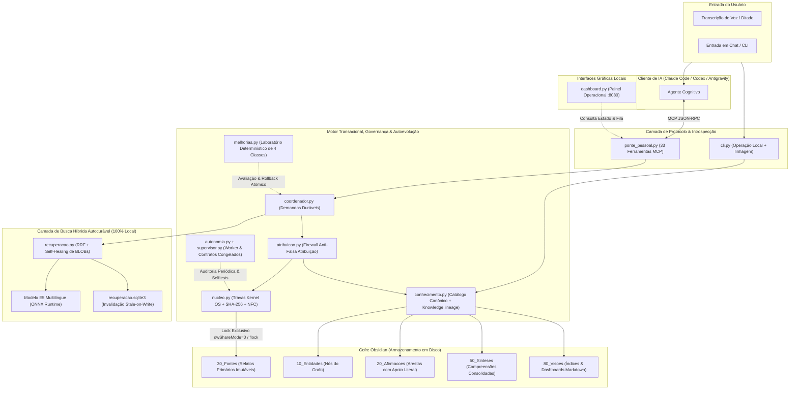
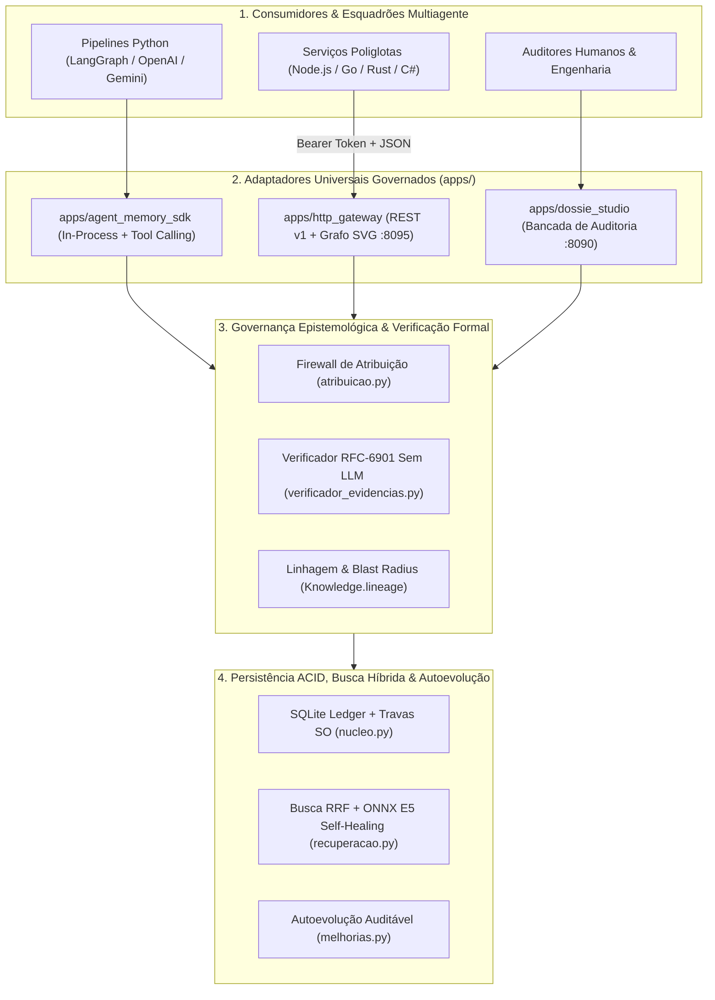
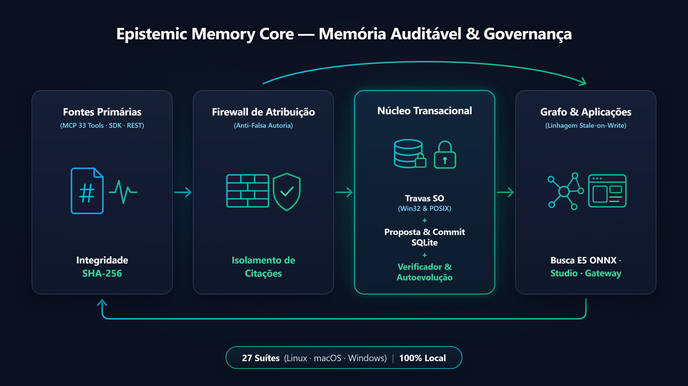
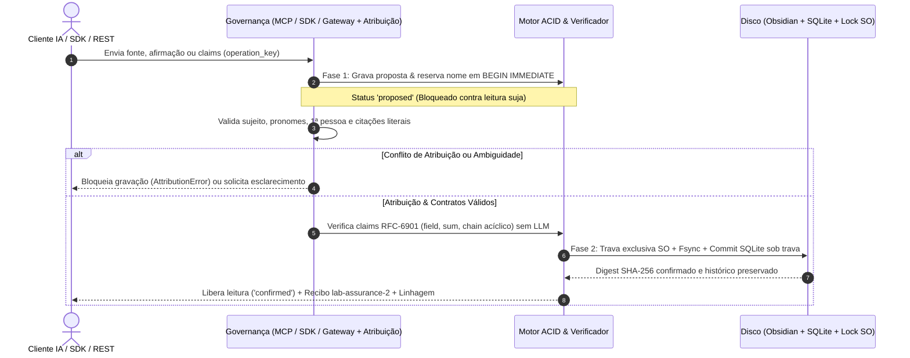

# Epistemic Memory Core — Protocolo Universal de Memória Estruturada para IA

> **Motor de memória auditável, governança epistemológica e busca híbrida local para assistentes e malhas multiagente de IA — acessível via Model Context Protocol (MCP), SDK Python *in-process*, Gateway HTTP/REST e Obsidian.**

🇺🇸 [Read in English](README.en.md) · 🏛️ [Epistemic Dossier Studio](apps/dossie_studio/README.md) · 🧠 [Agent Memory SDK](apps/agent_memory_sdk/README.md) · 🕸️ [HTTP Gateway & Lineage UI](apps/http_gateway/README.md) · 📖 [Manual de Arquitetura (17 Capítulos)](00_Manual/indice-manual-cerebro.md)

[](https://github.com/leoguimaraes49/epistemic-memory-core/actions/workflows/testes.yml)
[](https://www.python.org/)
[](https://modelcontextprotocol.io/)
[-green.svg)](https://github.com/microsoft/onnxruntime)
[](https://obsidian.md/)
[](#-suíte-de-testes-automatizados)
[](https://github.com/leoguimaraes49/epistemic-memory-core/releases/tag/v0.5.8)

---

## 💡 O que é o projeto?

O **Epistemic Memory Core** é uma infraestrutura determinística projetada para resolver os quatro maiores gargalos de confiabilidade em sistemas de memória para Inteligência Artificial:

1. **Amnésia e Alucinação Cumulativa:** Assistentes tradicionais misturam fatos observados com inferências sintéticas e continuam servindo conclusões antigas mesmo após uma premissa primária ser retificada.
2. **Corrupção de Estado e Condições de Corrida (*Race Conditions*):** Múltiplos processos ou agentes escrevendo simultaneamente sem travas exclusivas de sistema operacional, reserva atômica de nomes e retenção de trava durante o `COMMIT`.
3. **Leituras Sujas (*Dirty Reads*):** Modelos consumindo rascunhos, propostas interrompidas ou arquivos truncados como se fossem dados canônicos consolidados.
4. **Falsa Atribuição de Autoria:** Confusão semântica ao atribuir falas de terceiros, métricas numéricas trocadas ou documentos externos em primeira pessoa ao sujeito errado.

O sistema implementa um **protocolo rigoroso de memória governada**: identificadores únicos imutáveis (`UUIDv4`), histórico de revisões em cadeia de custódia, resumo criptográfico `SHA-256` em cada arquivo, introspecção determinística de linhagem e raio de impacto (`Knowledge.lineage`), verificação formal de alegações sem chamadas pagas a LLMs (`lab-assurance-2`), laboratório determinístico de autoevolução controlada e separação epistemológica estrita entre **fontes primárias (`30_Fontes`)** e **conhecimento derivado**.

---

## 🏛️ Diagramas Arquiteturais de Funcionamento

### Cenário 1: Gestão Pessoal de Conhecimento (Second Brain com Obsidian)

Neste modo, o motor atua como infraestrutura de apoio cognitivo pessoal, alimentando um cofre do Obsidian com dados auditáveis, busca híbrida autocurável e navegação em grafo.



---

### Cenário 2: Malha Universal para Software & Agentes Autônomos (SDK + HTTP Gateway + Studio)

O mesmo motor desacopla-se do uso pessoal para operar como **camada universal de memória auditável** em Python (*in-process*) ou para qualquer linguagem (Node.js, Go, Rust, C#, microsserviços) via REST JSON:



#### Aplicações Industriais & de Software:
- **Orquestração Multiagente (LangGraph, OpenAI Agents, Gemini SDK):** Compartilhamento *in-process* de memória entre agentes pesquisadores, verificadores e decisores com chaves determinísticas de idempotência e bloqueio imediato de alucinações de autoria.
- **Área Jurídica & Compliance:** Auditoria de contratos (MSA e aditivos) onde nenhuma síntese permanece vigente sem apoio literal na revisão atual do documento primário.
- **Fintech, Engenharia & Operações Críticas:** Registro de cotações, SLAs e decisões arquiteturais com comprovantes matemáticos determinísticos (`field`, `sum`, `chain`) no formato `lab-assurance-2`.

---

### Cenário 3: Fluxo Completo de Ponta a Ponta (*End-to-End Lifecycle*)

Abaixo está o ciclo de vida completo de uma operação governada, desde a submissão até a confirmação física e introspecção de impacto:





---

## 🧩 Adaptadores e Aplicações Inclusas (`apps/`)

Além do servidor MCP (`src/ponte_pessoal.py`) e do painel operacional (`src/dashboard.py`), o repositório entrega **três pacotes prontos em `apps/`** construídos integralmente sobre os contratos canônicos do motor:

### 1. Epistemic Agent Memory SDK (`apps/agent_memory_sdk/`)
SDK Python *in-process* e adaptador universal de *Function Calling* para acoplar memória auditável diretamente em agentes **LangGraph**, **OpenAI** ou **Google Gemini** sem subprocessos MCP. Consulte o [guia completo do SDK](apps/agent_memory_sdk/README.md).
- **API tipada e idempotente:** `make_operation_key()`, `remember_source()`, `rectify_source()`, `register_entity()`, `assert_fact()` (com firewall `atribuicao.py` obrigatório para relatos pessoais), `synthesize()`, `prepare_decision()`, `verify_claims()`, `recall_context()` e `blast_radius()`.
- **Exportação nativa de ferramentas para LLMs:** `as_openai_tools(strict=True)`, `as_gemini_declarations()` e despachante seguro `dispatch_tool_call(name, arguments)` com códigos de erro determinísticos (`ATTRIBUTION_FIREWALL_BLOCKED`, `REVISION_CONFLICT`, `VALIDATION_ERROR`, etc.) e isolamento estrito de `register_human_review`.

```powershell
# Executar demonstração multiagente ponta a ponta (Pesquisador -> Verificador -> Decisor -> Cascata)
.\.venv\Scripts\python.exe apps/agent_memory_sdk/cli_demo.py --workspace ./testes_temporarios/sdk-demo --cleanup
```

### 2. Epistemic HTTP Gateway & Live Lineage Graph Explorer (`apps/http_gateway/`)
Servidor REST `ThreadingHTTPServer` endurecido (`127.0.0.1:8095`, zero dependências externas além da biblioteca padrão + motor) para integração poliglota (**Node.js, Go, Rust, C#, webhooks**) acompanhado de um **Inspetor Visual SVG Interativo de Grafo e Linhagem**. Consulte a [documentação da API REST](apps/http_gateway/README.md).
- **Rotas REST v1 (`/api/v1/*`):** `GET /health`, `GET /graph`, `GET /lineage/<record_id>`, `POST /sources`, `POST /sources/rectify`, `POST /knowledge`, `POST /verify-claims` e `POST /search`.
- **Segurança de transporte local:** proteção contra *DNS Rebinding* (`Host` -> `HTTP 403`), autenticação constante no tempo `Authorization: Bearer <token>` via `hmac.compare_digest` (`HTTP 401`), limite rígido de `64 KB` por payload (`HTTP 413`), `Content-Security-Policy` e escapamento anti-XSS em HTML/SVG.

```powershell
# Subir o Gateway REST + Inspetor Visual SVG em http://127.0.0.1:8095 (ou usar o comando instalado emc-gateway)
.\.venv\Scripts\python.exe apps/http_gateway/cli.py --workspace ./testes_temporarios/meu-gateway serve --port 8095 --seed-demo
```

### 3. Epistemic Dossier Studio (`apps/dossie_studio/`)
Bancada web (`127.0.0.1:8090`) e CLI para auditoria interativa de decisões de engenharia, contratos jurídicos e protocolos experimentais. Consulte o [README do Studio](apps/dossie_studio/README.md).
- **3 cenários prontos em 1 clique:** *Engenharia & Cloud (`engenharia_cotacao`)*, *Jurídico & Compliance (`juridico_contrato`)* e *Pesquisa & Produtividade (`pesquisa_decisao`)*.
- **Simulador *Stale-on-Write*:** retifique uma cotação ou cláusula e inspecione o *diff* unificado junto à suspensão automática em cascata de sínteses, pontuações e recibos `lab-assurance-2`.

```powershell
# Iniciar o Epistemic Dossier Studio (ou usar emc-dossie após pip install -e .)
.\.venv\Scripts\python.exe apps/dossie_studio/cli.py --workspace ./meu-dossie serve --preload engenharia_cotacao
```

---

## 🔍 Introspecção de Linhagem, Laboratório de Autoevolução e Painel Local

### Linhagem Determinística & Raio de Impacto (`Knowledge.lineage` / CLI `linhagem`)
Qualquer registro (`30_Fontes` ou derivado) pode ter sua árvore completa de proveniência e impacto auditada deterministicamente via Python (`Knowledge(store).lineage(record_id)`) ou terminal:
- **Bases *upstream* diretas e transitivas:** lista fontes primárias (`30_Fontes`) e registros intermediários com comparação entre revisão pinada (`pinned_revision`) e revisão vigente (`current_revision`), detecção de fontes excluídas (`excluded`) e validade `SHA-256`.
- **Raio de impacto *downstream* (`blast_radius`):** agrupa dependentes diretos e transitivos em `active` vs. `suspended` (respeitando referências históricas legítimas como `question.trigger_refs` e `source.parent_source_ref`), com travessia segura contra ciclos (BFS + DFS tricolor).

```powershell
.\.venv\Scripts\python.exe src/cli.py linhagem <RECORD_ID>
```

### Laboratório Determinístico de Autoevolução (`src/melhorias.py`)
O módulo de evolução opera sob limites estritos de não-escalação de privilégios (validado em sandbox AST isolado), suportando avaliação reproduzível, adoção atômica e *rollback* verificado em LIFO para **4 classes de configuração** em `config/execucao.json`:
1. **`message_codec`** (`compact` vs. `pretty`): redução medida de payload com igualdade exata de *roundtrip* JSON.
2. **`retrieval_policy`** (`lexical` vs. `hybrid`): alinhamento determinístico aos canais efetivamente respaldados por embeddings locais, preservando âncoras lexicais.
3. **`vector_storage`** (`packed_f64` vs. `json` / `packed_f32`): adoção de empacotamento binário IEEE-754 `float64` sem perda de precisão (rejeitando truncamento `float32` com perda).
4. **`batch_limits`** (`max_actions`, `max_model_calls`, `max_seconds`): contenção Pareto-segura de exposição sem estrangular perfis canônicos de demanda e jamais ampliando franquias de modelo ou habilitando provedores desativados.
- Inclui auditoria criptográfica de cadeia (`audit_adoption_chain()` e `diagnostics_summary()`) capaz de detectar deriva externa em `execucao.json`, elos quebrados ou adulteração de *journals* em `estado/adocoes/`.

### Interface Web Operacional (`src/dashboard.py`)
Painel complementar em `http://127.0.0.1:8080` construído com a biblioteca padrão do Python para inspecionar saúde do *worker*, último `autoteste`, buscas híbridas, demandas pendentes e envio de tarefas de manutenção (`audit_vault`, `refresh_view`, `selftest`). Veja o [guia de autonomia](docs/guias/AUTONOMIA.md).

---

## 📂 Estrutura do Repositório

```text
├── 00_Manual/                   # Especificação formal imutável (17 capítulos normativos + manifesto SHA-256)
├── apps/                        # Adaptadores universais e aplicações sobre os contratos canônicos
│   ├── agent_memory_sdk/        # SDK Python in-process + Function Calling (OpenAI, Gemini, LangGraph)
│   ├── dossie_studio/           # Bancada Web (:8090) + CLI de auditoria de decisões e contratos
│   └── http_gateway/            # Gateway REST JSON v1 (:8095) + Inspetor Visual SVG de Linhagem
├── config/                      # Configurações e manifestos (autonomia.json, execucao.json, manual_manifest.json)
├── docs/                        # Diagramas visuais de arquitetura e guias operacionais
│   ├── arquitetura.jpg          # Diagrama visual da arquitetura v0.5.8 (PT-BR)
│   ├── architecture-en.jpg      # Diagrama visual da arquitetura v0.5.8 (EN)
│   └── guias/
├── scripts/                     # Utilitários de inicialização, benchmark de escala e caos multiprocesso
│   ├── benchmark_escala.py      # Benchmark multiprocesso, recuperação pós-falha e escala com ONNX E5
│   ├── stress_caos_concorrencia.py # Stress test multiprocesso (6 workers, CAS, ONNX E5, recibos e leases)
│   ├── iniciar-template.py      # Assistente de inicialização de cofre limpo para novos usuários
│   └── iniciar-trabalhador.ps1  # Inicializador do worker em segundo plano (Windows)
├── src/                         # Código-fonte do motor epistêmico (24 módulos Python)
│   ├── nucleo.py                # Persistência ACID: travas SO exclusivas, SHA-256, sanitização NFC e SQLite
│   ├── conhecimento.py          # Catálogo canônico, validação de esquemas, cascata stale e Knowledge.lineage()
│   ├── evidencias.py            # Adaptador de comprovantes estruturados e suplementação seletiva
│   ├── verificador_evidencias.py # Verificador stdlib RFC-6901 de claims (field, sum sem bool, chain acíclico)
│   ├── atribuicao.py            # Firewall de atribuição: isolamento estrito de sujeito, citações e métricas
│   ├── apoio_decisao.py         # Estruturação auditável de decisões, opções, prós/contras e lacunas
│   ├── recuperacao_fila.py      # Recuperação resiliente da fila SQLite e contratos de continuação congelados
│   ├── supervisor.py            # Supervisor de monitoramento contínuo do processo trabalhador
│   ├── coordenador.py           # Gerenciador durável de demandas, etapas e orçamentos
│   ├── recuperacao.py           # Busca híbrida RRF (ONNX E5 local + léxica + grafo) com self-healing de BLOBs
│   ├── autonomia.py             # Fila durável de tarefas e trabalhador (worker) com verificação code_hash
│   ├── autoteste.py             # Executor criptográfico das 27 suítes oficiais por hash de código
│   ├── ponte_pessoal.py         # Servidor Model Context Protocol (MCP) com 33 ferramentas locais
│   ├── dashboard.py             # Painel web operacional local (:8080, zero dependências externas)
│   ├── cli.py                   # CLI local (fontes, conhecimento, demandas, comprovantes e linhagem)
│   ├── esquemas.py              # Contratos e validadores tipados dos registros (brain-json)
│   ├── avaliacoes.py            # Contratos para instrumentos e cálculo determinístico de escores
│   ├── documentos.py            # Registro e validação de documentos estruturados e parent_source_ref
│   ├── execucao.py              # Orquestração da fila integrada e ciclo de leitura/extração
│   ├── revalidacao.py           # Revisão semântica controlada pós-retificação preservando histórico humano
│   ├── pesquisa.py              # Integração controlada com Crossref com retomada idempotente
│   ├── provedores.py            # Chamada segura a modelos textuais em subprocesso isolado sem ferramentas
│   ├── melhorias.py             # Laboratório determinístico de 4 classes + auditoria criptográfica de cadeia
│   └── revisoes.py              # Registro autorizado de confirmações e contestações humanas
├── tests/                       # 27 suítes oficiais (autoteste) + 2 scripts MCP de regressão + apoio_testes04.py
├── LICENSE                      # Licença personalizada: Non-Commercial Source-Available Exclusiva do Autor
├── README.md                    # Documentação principal (Português)
├── README.en.md                 # Documentação principal (Inglês)
├── pyproject.toml               # Pacote v0.5.8 e 6 CLIs (emc, emc-mcp, emc-dashboard, emc-verifier, emc-dossie, emc-gateway)
└── requirements-execucao04.txt  # Dependências Python fixadas
```

---

## 📖 O Manual de Arquitetura (17 Capítulos)

O diretório [`00_Manual/`](00_Manual/) contém a especificação formal protegida por manifesto `SHA-256` (`config/manual_manifest.json`) que rege todo o sistema:

| Capítulo | Nome | Finalidade |
| :--- | :--- | :--- |
| **01** | Fundamentos | Princípios epistemológicos, não-alucinação e primazia da evidência. |
| **02** | Processos e Contratos | Fluxo dos 14 processos formais (P01 a P14). |
| **03** | Estados e Execução | Máquinas de estados para fontes, entidades, afirmações e demandas. |
| **04** | Interações e Políticas | Políticas de acesso, retenção, consentimento e segurança. |
| **05** | Memória de Busca | Diretrizes para indexação, busca híbrida e expiração de cache. |
| **06** | Modelo de Registros | Especificação do cabeçalho YAML e payload tipado `brain-json`. |
| **07** | Experiências e Entrevista | Condução da entrevista ampla e coleta contextual. |
| **08** | Catálogo de Dados | Tipos de entidades (`person`, `project`, `habit`, etc.) e predicados. |
| **09** | Registros Operacionais | Logs, histórico de consultas e auditoria técnica. |
| **10** | Relações e Validação | Regras de validação de arestas, ciclos e vedação de diagnóstico implícito. |
| **11** | Representação e Acesso | Visualização em grafo (cores por pasta) e interfaces. |
| **12** | Execução Verificada | Especificação da Extensão 0.2 (MCP de conhecimento e autotestes). |
| **13** | Autonomia Local | Especificação da Entrega 0.3 (Worker local e fila persistente). |
| **14** | Execução Integrada | Busca E5 local ONNX, coordenador durável e laboratório de autoevolução. |
| **15** | Garantias de Execução | Reserva atômica de nomes, bloqueio de dirty reads e recibos `lab-assurance-2`. |
| **16** | Retomada e Supervisão | Recuperação controlada de tarefas expiradas e supervisor do worker. |
| **17** | Atribuição e Continuações | Isolamento estrito de sujeito/citações e contratos de fila congelados. |

---

## 🚀 Como Começar do Zero (Template Limpo)

O guia funciona em **Windows (PowerShell)**, **Linux** e **macOS**.

### 1. Clonar e Instalar Dependências (Python 3.11 ou 3.12)

```powershell
git clone https://github.com/leoguimaraes49/epistemic-memory-core.git
cd epistemic-memory-core

python -m venv .venv
.\.venv\Scripts\python.exe -m pip install -r requirements-execucao04.txt
# Instalação editável opcional (habilita emc, emc-mcp, emc-dashboard, emc-verifier, emc-dossie e emc-gateway):
.\.venv\Scripts\python.exe -m pip install --no-deps -e .
```

No Linux ou macOS:

```bash
python3 -m venv .venv
./.venv/bin/python -m pip install -r requirements-execucao04.txt
./.venv/bin/python -m pip install --no-deps -e .
```

### 2. Inicializar um Novo Cofre Vazio e Abrir o Painel
```powershell
.\.venv\Scripts\python.exe scripts/iniciar-template.py --destino ./meu-cofre --nome "Meu Cérebro"
.\.venv\Scripts\python.exe src/dashboard.py
# Painel disponível em http://127.0.0.1:8080
```

### 3. Conectar seu Assistente de IA via MCP (33 Ferramentas)
Use o Python do ambiente virtual e o caminho absoluto de `src/ponte_pessoal.py`, habilitando explicitamente `CEREBRO_PESSOAL_ACESSO=permitido`:

```json
{
  "mcpServers": {
    "cerebro_pessoal": {
      "command": "C:/caminho/epistemic-memory-core/.venv/Scripts/python.exe",
      "args": ["C:/caminho/epistemic-memory-core/src/ponte_pessoal.py"],
      "env": { "CEREBRO_PESSOAL_ACESSO": "permitido" }
    }
  }
}
```

No Linux ou macOS, use caminhos absolutos para `.venv/bin/python` e `src/ponte_pessoal.py`. Veja também o [guia de execução integrada](docs/guias/EXECUCAO-INTEGRADA.md).

---

## Busca Vetorial Local (ONNX E5)

A etapa semântica utiliza o modelo `intfloat/multilingual-e5-small` localmente em CPU, conferido por `SHA-256` antes da carga. Os dois arquivos também são exigidos para aprovar a bateria completa (`status: "passed"`) em `autotestes`. Salve-os em `modelos/e5-multilingual-small/`:

- [model.onnx](https://huggingface.co/intfloat/multilingual-e5-small/blob/614241f622f53c4eeff9890bdc4f31cfecc418b3/onnx/model.onnx) (470 MB)
- [tokenizer.json](https://huggingface.co/intfloat/multilingual-e5-small/blob/614241f622f53c4eeff9890bdc4f31cfecc418b3/tokenizer.json) (17 MB)

Para habilitar no uso contínuo, defina `embeddings.enabled` como `true` em `config/execucao.json` (ou aponte `EMC_EMBEDDINGS_DIR` para a pasta validada).

---

## 🧪 Suíte de Testes Automatizados (27 Suítes Oficiais)

O repositório é validado por **27 suítes automatizadas** registradas em [`src/autoteste.py`](src/autoteste.py) e cobertas por hash criptográfico em [`src/autonomia.py`](src/autonomia.py), executadas continuamente no GitHub Actions em **Ubuntu 24.04 (Python 3.11 & 3.12)**, **macOS 15 (Python 3.12)** e **Windows Server 2022 (Python 3.12)**.

```powershell
# 1. Executar a bateria oficial completa das 27 suítes com verificação por hash de código
$env:CEREBRO_PESSOAL_ACESSO = "permitido"
.\.venv\Scripts\python.exe src/cli.py autotestes

# 2. Executar stress test multiprocesso de caos, concorrência, ONNX E5 e expiração de leases
.\.venv\Scripts\python.exe scripts/stress_caos_concorrencia.py --workers 6 --ops 15

# 3. Opcional: benchmark de escala em volume (~480+ registros)
.\.venv\Scripts\python.exe scripts/benchmark_escala.py --fontes 120
```

No Linux ou macOS: `CEREBRO_PESSOAL_ACESSO=permitido ./.venv/bin/python src/cli.py autotestes`.

### Destaques das 27 Suítes Cobertas:
- **`tests/testes_agent_sdk.py`**: SDK Python *in-process*, idempotência pós-reinício, esquemas OpenAI/Gemini, `dispatch_tool_call`, firewall de atribuição e cascata `stale`.
- **`tests/testes_http_gateway.py`**: Gateway HTTP/REST (`401`/`403`/`413`/`422`), CSP e UI SVG, fluxo completo `30_Fontes -> 50_Sinteses`, recibos e raio de impacto concorrente.
- **`tests/testes_hardening_motor.py`**: Linhagem multi-salto (`Knowledge.lineage` e CLI `linhagem`), *self-healing* de BLOBs vetoriais corrompidos/NaN/Inf com ONNX E5, ponteiros RFC-6901, rejeição de booleanos em `sum`, ciclos em `chain` e sanitização Unicode NFC/dispositivos Windows.
- **`tests/testes_fuzz_caos.py`**: Fuzzing determinístico com semente fixa, diálogos adversariais com 5+ interlocutores e homônimos, morte abrupta de processo (`os._exit`) e bloqueio estrito de *dirty reads*.
- **`tests/testes_evolucao_lab.py`**: Avaliadores determinísticos das 4 classes (`message_codec`, `retrieval_policy`, `vector_storage`, `batch_limits`), reversão LIFO, bloqueio de deriva concorrente e auditoria criptográfica `audit_adoption_chain()` em sandbox AST.
- **`tests/testes_dossie_studio.py`**, **`tests/testes_auditoria_escala.py`** & **`tests/testes_dashboard.py`**: Cenários do Dossier Studio, escala com centenas de registros e segurança dos painéis web locais.
- **Núcleo, Persistência, MCP, Fila & Atribuição (`19 suítes base`)**: `testes.py`, `testes_conhecimento.py`, `testes_autonomia.py`, `testes_decisao.py`, `testes_esquemas.py`, `testes_recuperacao.py`, `testes_coordenador.py`, `testes_execucao.py`, `testes_runtime.py`, `testes_provedores.py`, `testes_mcp_vetores.py`, `testes_evidencias.py`, `testes_persistencia05.py`, `testes_mcp05.py`, `testes_recuperacao_fila.py`, `testes_melhorias_seguranca.py`, `testes_operacao_melhorias.py`, `testes_atribuicao.py` e `testes_continuacoes07.py` (além dos scripts `tests/teste_mcp.py` e `tests/testes_mcp04.py`).

---

## 🛡️ Garantias e Limites Conscientes

- **Controles implementados:** conferência local por `SHA-256`, histórico auditável de revisões, travas exclusivas por plataforma retidas até o `COMMIT` SQLite, autocura de vetores corrompidos, linhagem determinística e recibos verificáveis sem LLM.
- **Travas por plataforma:** o Windows bloqueia abertura concorrente via `CreateFileW` (`dwShareMode=0`); em POSIX (Linux/macOS), `flock` coordena processos cooperativos combinado a `verify_posix_file` (`pread`/`fstat`) contra substituição externa. Consulte [Garantias de Execução](00_Manual/manual-cerebro-15-garantias-de-execucao.md#arquivos-controlados-por-plataforma).
- **O que este sistema NÃO faz:** não inventa diagnósticos clínicos, não emite probabilidades sem suporte empírico, não envia dados pessoais para serviços externos não autorizados e jamais autoaprova código arbitrário ou escalação de permissões.

---

## 📄 Licença

Disponibilizado sob licença personalizada **Non-Commercial Source-Available** ([`LICENSE`](LICENSE)) de autoria exclusiva de **Leonardo Guimarães (`@leoguimaraes49`)**:
- ✅ **Permitido:** Estudo, auditoria de código, pesquisa acadêmica e uso estritamente pessoal sem fins lucrativos.
- ❌ **Proibido a terceiros:** Uso comercial, revenda, exploração como SaaS/serviço hospedado ou integração em produtos comerciais sem licença prévia por escrito do Autor.
