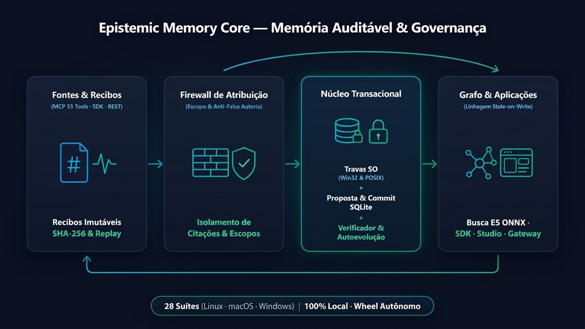
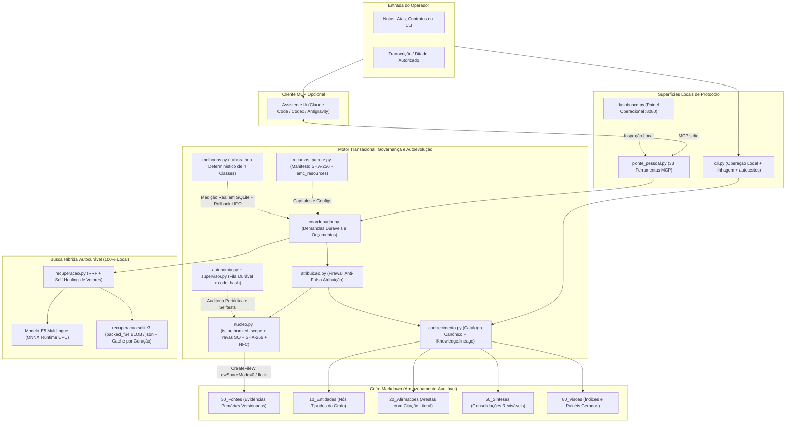
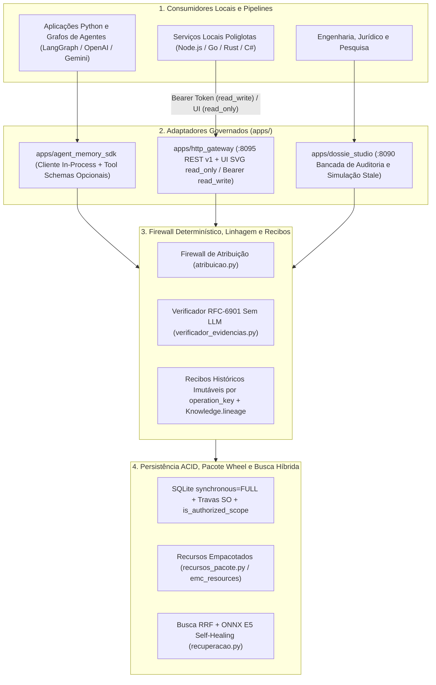
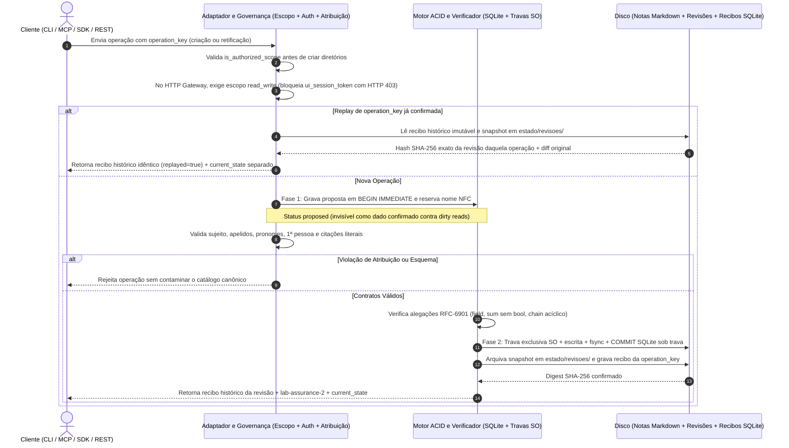

# Arquitetura Detalhada — Epistemic Memory Core (`v0.5.9`)

> **Documento de referência técnica complementar ao [`README.md`](../../README.md) ([`README.en.md`](../../README.en.md)) e subordinado à especificação normativa em [`00_Manual/`](../../00_Manual/indice-manual-cerebro.md).**

⬅️ [Voltar ao README Principal](../../README.md) · 🇺🇸 [English Landing Page](../../README.en.md) · 📖 [Índice do Manual (17 Capítulos)](../../00_Manual/indice-manual-cerebro.md) · ⚙️ [Execução 0.2](EXECUCAO.md) · 🔄 [Autonomia 0.3](AUTONOMIA.md) · 🧩 [Execução Integrada 0.4](EXECUCAO-INTEGRADA.md)

---

## 1. Visão Geral em Camadas

O **Epistemic Memory Core** separa estritamente a **evidência primária imutável** (`30_Fontes`) do **conhecimento derivado** (`10_Entidades`, `20_Afirmacoes`, `50_Sinteses`, `80_Visoes`), operando de forma 100% local sobre SQLite transacional e arquivos Markdown auditáveis por `SHA-256`. O motor funciona integralmente sem chamadas obrigatórias a modelos de linguagem: agentes de IA via MCP, SDK ou REST são consumidores opcionais submetidos ao mesmo firewall determinístico.

---

## 2. Cenários de Operação (Diagramas Mermaid)

### Cenário A — Gestão Pessoal de Conhecimento (Cofre Obsidian, CLI e MCP)

Neste fluxo, o motor opera como infraestrutura local de memória auditável sobre um cofre do Obsidian, acessível diretamente via terminal (`emc` / `src/cli.py`), painel operacional (`:8080`) ou assistentes compatíveis com Model Context Protocol (`src/ponte_pessoal.py`).

---

### Cenário B — Malha Universal para Software e Sistemas Multiagente (`apps/`)

O mesmo motor atua como biblioteca Python *in-process*, serviço HTTP/REST local para qualquer linguagem de programação ou bancada interativa de auditoria técnica e contratual:

---

### Cenário C — Ciclo Transacional Ponta a Ponta e Replay de Recibo Histórico (`v0.5.9`)

Toda escrita atravessa validação prévia de escopo, proposta durável antes de tocar o arquivo de destino, verificação determinística e persistência de comprovante histórico imutável por `operation_key`:

---

## 3. Garantias Arquiteturais e Modelo de Segurança Local (`v0.5.9`)

### 3.1. Recibos Históricos Imutáveis vs. Estado Vigente (`current_state`)
Quando uma fonte passa por múltiplas revisões (por exemplo, revisão `1 -> 2 -> 3`) e um cliente repete a `operation_key` da criação (`rev 1`) ou da primeira retificação (`1 -> 2`) — inclusive após reiniciar o processo —, o SDK (`estado/sdk_operacoes.sqlite3`) e o HTTP Gateway (`estado/gateway_operacoes.sqlite3`) reconstituem a prova exata daquela operação a partir dos snapshots em `estado/revisoes/<id>/<rev>.md` e `estado/conhecimento_revisoes/`:
- Os campos de topo do recibo devolvem o `revision`, `sha256`, `old_sha256`, `new_sha256`, `diff` exato entre `from_revision` e `to_revision`, `revision_count_at_operation` e `newly_suspended_ids` **da operação original**, marcados com `"replayed": true`.
- Qualquer informação calculada no momento da consulta é isolada exclusivamente no subobjeto `"current_state"` (`current_revision`, `current_sha256`, `total_revisions`, `currently_stale_ids` / `currently_suspended_ids`), evitando misturar prova histórica com estado posterior do cofre.

### 3.2. Fronteira de Confiança Local do HTTP Gateway (`read_only` vs. `read_write`)
Em máquinas compartilhadas ou ambientes com múltiplos agentes locais, escutar apenas em `127.0.0.1` não equivale a confiar escrita irrestrita a qualquer processo local:
- **`ui_session_token` (`read_only`):** emitido no carregamento da página inicial (`GET /`) apenas para alimentar o Inspetor Visual SVG de Grafo e Linhagem (`GET /api/v1/health`, `GET /api/v1/graph`, `GET /api/v1/lineage/<id>` e consulta sem mutação canônica). Qualquer tentativa de escrita (`POST /api/v1/sources`, `/api/v1/sources/rectify`, `/api/v1/knowledge`, `/api/v1/verify-claims`) com credencial `read_only` é recusada com **`HTTP 403`** (`"error": "insufficient_scope"`).
- **Token de Operador `Bearer` (`read_write`):** configurado via `--api-token` ou `EMC_GATEWAY_TOKEN` (ou exibido no console local do operador e informado apenas em memória na barra da UI), exigido por comparação em tempo constante (`hmac.compare_digest`) para todas as mutações, aliado à validação anti-*DNS Rebinding* do cabeçalho `Host` e teto de `64 KB` por requisição.

### 3.3. Autorização Prévia de Escopo (`is_authorized_scope`) e Limpeza Isolada
- Antes de criar qualquer diretório ou banco SQLite, `nucleo.is_authorized_scope(root, vault)` verifica se os caminhos pertencem ao par principal (`EMC_SYSTEM` + `EMC_VAULT`), à árvore de testes (`testes_temporarios/`) ou a uma raiz explicitamente listada em `EMC_AUTHORIZED_ROOTS` (separada por `;` no Windows ou `:` em Linux/macOS).
- Caminhos fora de escopo falham imediatamente com `Invalid("raiz fora do escopo autorizado")`, deixando pastas vazias intocadas no SDK, no Gateway e no Dossier Studio.
- Os utilitários de demonstração (`apps/agent_memory_sdk/cli_demo.py` e `apps/http_gateway/cli.py`) criam um subdiretório descartável exclusivo dentro de `--workspace` e restringem `--cleanup` unicamente a esse subdiretório filho, preservando quaisquer arquivos preexistentes no diretório pai mesmo em caso de falha de inicialização.

### 3.4. Empacotamento Wheel Autossuficiente (`emc_resources` e `recursos_pacote.py`)
Ao empacotar o projeto em `.whl` (inclusive a partir de `git archive`), os capítulos normativos de `00_Manual/*.md` e os manifestos de `config/*.json` (`manual_manifest.json`, `execucao.json`, `autonomia.json`) são embarcados no pacote de recursos `emc_resources`. O módulo `src/recursos_pacote.py` carrega e valida o `SHA-256` de cada capítulo via `importlib.resources` quando executado fora do clone Git, permitindo inicializar `emc`, `emc-gateway`, `emc-dossie` e `EpistemicMemoryClient` a partir de qualquer diretório externo autorizado.

### 3.5. Linhagem Determinística e Laboratório de Autoevolução Controlada
- **Introspecção de Linhagem (`Knowledge.lineage` / CLI `emc linhagem <ID>`):** percorre o grafo com busca em largura e detecção tricolor de ciclos (DFS), reportando integridade `SHA-256` do alvo, bases *upstream* diretas e transitivas (`pinned_revision` vs. `current_revision` e fontes excluídas) e dependentes *downstream* separados em `active` vs. `suspended`.
- **Laboratório Determinístico (`src/melhorias.py`):** executável sob sandbox AST isolado (`python -I -B`), avalia quatro classes sem jamais escalar privilégios ou orçamentos de modelo:
  1. `message_codec` (`compact` vs. `pretty`, igualdade exata de *roundtrip* JSON);
  2. `retrieval_policy` (`lexical` vs. `hybrid`, alinhada à presença efetiva de embeddings locais);
  3. `vector_storage` (`packed_f64` binário IEEE-754 sem perdas vs. `json` em índice SQLite real fechado e reaberto no disco, rejeitando formatos com perda como `packed_f32`);
  4. `batch_limits` (`max_actions`, `max_model_calls`, `max_seconds` sob fronteira de Pareto segura).
- **Auditoria Iterativa de Cadeia (`audit_adoption_chain`):** reconstitui sequências longas (testada com **1.000+ adoções sequenciais** sem recursão entre janelas de tempo), distinguindo explicitamente cadeia íntegra (`valid`), ruptura estrutural (`broken` / `broken_chain`) e empate combinatório acima do teto explícito (`inconclusive` / `inconclusive_chain`).

---

## 4. Referência dos 25 Módulos do Motor ([`src/`](../../src/))

| Módulo | Responsabilidade Arquitetural |
| :--- | :--- |
| `nucleo.py` | Persistência ACID de fontes, validação prévia `is_authorized_scope`, travas SO exclusivas (`CreateFileW` / `flock` + `verify_posix_file`), `SHA-256` e normalização NFC. |
| `recursos_pacote.py` | Resolução híbrida (repositório ou `importlib.resources` em `emc_resources`) e bootstrap validado por `SHA-256` de `00_Manual/*.md` e `config/*.json` para instalações `.whl`. |
| `conhecimento.py` | Catálogo canônico (`10_Entidades`, `20_Afirmacoes`, `50_Sinteses`), validação de referências pinadas, cascata *stale-on-write* e `Knowledge.lineage()`. |
| `atribuicao.py` | Firewall determinístico de atribuição: isolamento de sujeito, homônimos, pronomes, métricas numéricas e citações literais. |
| `verificador_evidencias.py` | Verificador na biblioteca padrão (zero LLM) para ponteiros RFC-6901 (`field`), somas inteiras estritas sem booleanos (`sum`) e cadeias acíclicas (`chain`). |
| `evidencias.py` | Adaptador de comprovantes estruturados `lab-assurance-2`, vinculação à geração do cofre e suplementação seletiva. |
| `recuperacao.py` | Busca híbrida Reciprocal Rank Fusion (léxica + ONNX E5 local + grafo), armazenamento real `packed_f64` (`BLOB`) ou `json` (`TEXT`) e autocura de vetores corrompidos. |
| `melhorias.py` | Laboratório determinístico de 4 classes, medição em índice SQLite real, reversão LIFO e auditoria iterativa de cadeia para 1.000+ eventos. |
| `coordenador.py` | Orquestrador durável de demandas (`contribution`, `question`, `correction`, `research`, `improvement`, `outcome`, `revalidation`) e orçamentos. |
| `execucao.py` | Integração do motor, carregamento resiliente do manifesto normativo (disco ou `recursos_pacote`) e ciclo controlado de leitura/extração. |
| `autonomia.py` | Fila persistente (`estado/fila.sqlite3`), trabalhador local em segundo plano e bloqueio preventivo por divergência de `code_hash`. |
| `recuperacao_fila.py` | Reconciliação segura de tarefas expiradas e contratos de continuação congelados. |
| `supervisor.py` | Monitoramento local do processo trabalhador e diagnóstico de saúde. |
| `autoteste.py` | Executor oficial das 28 suítes automatizadas vinculadas à impressão digital criptográfica dos arquivos cobertos. |
| `ponte_pessoal.py` | Servidor Model Context Protocol (MCP `1.26`) expondo 33 ferramentas governadas via `stdio`. |
| `cli.py` | Interface de linha de comando (`emc`): gestão de fontes, conhecimento, demandas, comprovantes, `linhagem` e `autotestes`. |
| `dashboard.py` | Painel web operacional local (`127.0.0.1:8080`, biblioteca padrão) para inspeção de fila, saúde, buscas e manutenção. |
| `apoio_decisao.py` | Estruturação auditável de decisões em aberto, alternativas, critérios, prós/contras e lacunas sem execução autônoma externa. |
| `esquemas.py` | Contratos declarativos e validadores tipados dos blocos `brain-json` e cabeçalhos YAML. |
| `avaliacoes.py` | Contratos para instrumentos estruturados, respostas versionadas e cálculo determinístico de escores com itens reversos. |
| `documentos.py` | Validação de documentos estruturados, proveniência e vínculo `parent_source_ref`. |
| `revalidacao.py` | Fluxo controlado de revisão pós-retificação preservando histórico e exigindo novas citações literais vigentes. |
| `revisoes.py` | Registro auditável de confirmações e contestações humanas explícitas sobre versões específicas. |
| `pesquisa.py` | Consulta externa restrita a metadados bibliográficos permitidos (Crossref) sem envio de relatos pessoais. |
| `provedores.py` | Execução opcional de provedores textuais em subprocesso isolado, com limites rígidos e sem concessão de ferramentas. |

---

## 5. Especificação Normativa ([`00_Manual/`](../../00_Manual/indice-manual-cerebro.md) — 17 Capítulos)

Os capítulos abaixo constituem a fonte normativa protegida pelo manifesto `SHA-256` em `config/manual_manifest.json`:

| Capítulo | Documento | Escopo Normativo |
| :--- | :--- | :--- |
| **01** | [Fundamentos](../../00_Manual/manual-cerebro-01-fundamentos.md) | Princípios epistemológicos, primazia da evidência, identidade e limites. |
| **02** | [Processos e Contratos](../../00_Manual/manual-cerebro-02-processos-e-contratos.md) | Especificação formal dos 14 processos (P01 a P14). |
| **03** | [Estados e Execução](../../00_Manual/manual-cerebro-03-estados-e-execucao.md) | Máquinas de estados para fontes, conhecimento, espera, falha e retomada. |
| **04** | [Interações e Políticas](../../00_Manual/manual-cerebro-04-interacoes-e-politicas.md) | Políticas de acesso, retenção, consentimento, suficiência e autoridade. |
| **05** | [Memória de Busca](../../00_Manual/manual-cerebro-05-memoria-de-busca.md) | Indexação, histórico de consultas, receitas de percurso e invalidação de cache. |
| **06** | [Modelo de Registros](../../00_Manual/manual-cerebro-06-modelo-de-registros.md) | Estrutura canônica de cabeçalho YAML, bloco `brain-json` e avaliações. |
| **07** | [Experiências e Entrevista](../../00_Manual/manual-cerebro-07-experiencias-e-entrevista.md) | Coleta contextualizada, decisões, ações, resultados e pendências. |
| **08** | [Catálogo de Dados](../../00_Manual/manual-cerebro-08-catalogo-de-dados.md) | Tipos de entidades, fontes, afirmações, sínteses, questões e instrumentos. |
| **09** | [Registros Operacionais](../../00_Manual/manual-cerebro-09-registros-operacionais.md) | Diários de execução, confirmações, cobertura de índices e fila. |
| **10** | [Relações e Validação](../../00_Manual/manual-cerebro-10-relacoes-e-validacao.md) | Predicados permitidos, cardinalidades, ciclos e 22 regras formais de validação. |
| **11** | [Representação e Acesso](../../00_Manual/manual-cerebro-11-representacao-e-acesso.md) | Organização em pastas no cofre, cores de grafo e perfis de acesso. |
| **12** | [Execução Verificada](../../00_Manual/manual-cerebro-12-execucao-verificada.md) | Contratos da entrega 0.2: catálogo de conhecimento via MCP e autotestes por hash. |
| **13** | [Autonomia Local](../../00_Manual/manual-cerebro-13-autonomia-local.md) | Contratos da entrega 0.3: fila persistente, limites do trabalhador e parada segura. |
| **14** | [Execução Integrada](../../00_Manual/manual-cerebro-14-execucao-integrada.md) | Contratos da entrega 0.4: embeddings ONNX E5 locais, coordenador e laboratório. |
| **15** | [Garantias de Execução](../../00_Manual/manual-cerebro-15-garantias-de-execucao.md) | Reserva atômica de nomes, travas por plataforma, anti-*dirty-read* e `lab-assurance-2`. |
| **16** | [Retomada e Supervisão](../../00_Manual/manual-cerebro-16-retomada-e-supervisao.md) | Reconciliação de leases expiradas e supervisão contínua do trabalhador. |
| **17** | [Atribuição e Continuações](../../00_Manual/manual-cerebro-17-atribuicao-e-continuacoes.md) | Isolamento estrito de autoria/citações e contratos imutáveis de continuação na fila. |

---

## 6. Matriz das 28 Suítes Oficiais de Teste ([`tests/`](../../tests/))

Todas as **28 suítes** abaixo são executadas pelo portão criptográfico `src/cli.py autotestes` (além dos scripts independentes de protocolo `tests/teste_mcp.py` e `tests/testes_mcp04.py`) em Ubuntu 24.04 (Python 3.11 e 3.12), macOS 15 e Windows Server 2022:

| Domínio | Suítes Oficiais (`tests/`) | Garantias Exercitadas |
| :--- | :--- | :--- |
| **Empacotamento e Distribuição (`1`)** | `testes_empacotamento_wheel.py` | Geração limpa de `.whl` a partir dos arquivos rastreados, presença dos capítulos e manifestos em `emc_resources`, e execução real fora do clone Git (`Store`, SDK e HTTP Gateway). |
| **Adaptadores Universais (`3`)** | `testes_agent_sdk.py`, `testes_http_gateway.py`, `testes_dossie_studio.py` | Replay idempotente com recibos históricos exatos pré/pós-reinício, escopo `read_only` (`HTTP 403`) vs. `read_write` no Gateway, validação prévia de escopo sem criar pastas, `--cleanup` isolado e cenários do Studio. |
| **Hardening, Caos e Escala (`3`)** | `testes_hardening_motor.py`, `testes_fuzz_caos.py`, `testes_auditoria_escala.py` | `Knowledge.lineage`, autocura de vetores corrompidos/`NaN`/`Inf`, ponteiros RFC-6901, fuzzing Unicode/dispositivos Windows, matriz de 5+ interlocutores, queda abrupta (`os._exit`) e volume centenário. |
| **Laboratório de Autoevolução (`3`)** | `testes_evolucao_lab.py`, `testes_melhorias_seguranca.py`, `testes_operacao_melhorias.py` | Medição em índice SQLite real (`packed_f64` vs. `json` e rejeição de `packed_f32`), reversão LIFO, isolamento AST (`python -I -B`) e auditoria iterativa de 1.000+ adoções (`valid` / `broken` / `inconclusive`). |
| **Núcleo ACID, Fila, Atribuição e MCP (`18`)** | `testes.py`, `testes_conhecimento.py`, `testes_autonomia.py`, `testes_decisao.py`, `testes_esquemas.py`, `testes_recuperacao.py`, `testes_coordenador.py`, `testes_execucao.py`, `testes_runtime.py`, `testes_provedores.py`, `testes_mcp_vetores.py`, `testes_evidencias.py`, `testes_persistencia05.py`, `testes_mcp05.py`, `testes_recuperacao_fila.py`, `testes_atribuicao.py`, `testes_continuacoes07.py`, `testes_dashboard.py` | Travas SO exclusivas, reserva atômica, cascata *stale*, firewall de autoria, contratos congelados de fila, recibos `lab-assurance-2`, busca híbrida E5 e segurança dos painéis web locais. |
